# Technical Architecture Document: Autonomous Software Testing Agent

**Status:** Proposed architecture baseline  
**Version:** 1.0  
**Date:** 2026-11-18  
**Companion:** [PRD.md](PRD.md)  
**Implementation status:** Not started. No code or implementation work is authorized by this document.

## 1. Purpose and design constraints

This document turns the approved product direction into a system design. The architecture must support multi-select testing scope, approval of added recommendations, per-domain and consolidated reporting, language-neutral plans, pluggable test-language/framework adapters, isolated execution, quality evidence, traceability, change-aware selection, and bounded repair.

Design constraints:

1. Orchestrate one durable workflow; do not create an uncontrolled collection of conversational agents.
2. Keep repository analysis, test planning, generation, execution, evaluation, repair, and reporting as explicit stages with typed inputs/outputs.
3. Treat repository content, generated test code, dependency install hooks, test targets, and tool output as untrusted.
4. Require explicit user confirmation for scope expansion and sensitive repair actions.
5. Keep an adapter contract stable while individual ecosystems evolve.
6. Prefer deterministic parsing, existing test tools, and reproducible execution over bespoke AI-only behavior.

## 2. Context and component architecture

```mermaid
flowchart LR
  U[User: CLI / config / natural language] --> I[Input and scope resolver]
  I --> W[Workflow orchestrator: durable graph]
  W --> A[Repository intelligence]
  A --> P[Taxonomy registry and capability resolver]
  P --> R[Recommendation and approval gate]
  R --> T[Language-neutral test planner]
  T --> H[Plan review / approval]
  H --> G[Generation service]
  G --> AR[Language and framework adapter registry]
  AR --> X[Sandbox controller]
  X --> Q[Quality and evidence engine]
  Q --> D{Repair eligible?}
  D -->|bounded and policy allowed| F[Repair proposal]
  F --> H
  D -->|no / exhausted| RP[Report composer]
  Q --> RP
  RP --> O[Domain reports + consolidated report]
  W --- S[(Run state / audit / artifacts)]
  MCP[Thin MCP interface] --> I
  CI[CI runner] --> I
```



The MCP server and CI runner are clients of the same application service/use-case layer. Neither contains a separate testing engine. The sandbox controller is a security boundary and does not accept free-form LLM commands without policy validation.

### Logical components

| Component | Responsibility | Key boundary |
|---|---|---|
| CLI / MCP / CI entrypoints | Parse request, authenticate local caller as applicable, invoke use cases, render status | Cannot bypass scope/policy checks |
| Scope resolver | Merge CLI, project configuration, natural-language request, and policy; produce canonical scope | Recommendations remain pending until approval |
| Repository intelligence | Discover project structure, symbols, dependencies, tests, APIs, schemas, and changes | Read-only view; never executes project code during static analysis |
| Taxonomy/capability registry | Canonical type IDs, aliases, dimensions, prerequisites, adapters, risk labels | Versioned and schema-validated |
| Workflow orchestrator | Durable stages, checkpoints, approval interrupts, retries, cancellation, run history | State transitions validated; no hidden side effects |
| Test planner | Produce language-neutral scenarios tied to evidence | Does not generate or execute tests |
| Generation service | Request tests from registered adapter using approved plan | Writes only to designated generated-artifact area |
| Adapter registry | Detect, validate, generate, execute, parse, and report ecosystem-specific behavior | Adapter commands/data are constrained by policy |
| Sandbox controller | Create, monitor, and destroy isolated execution environments | Host-side policy enforcement; untrusted container output |
| Quality/evidence engine | Normalize results and evaluate configured quality gates | Missing metric is unknown, not pass |
| Repair controller | Classify failures and permit bounded repair proposals | Assertion/application behavior changes require approval |
| Report composer | Per-domain and consolidated Markdown/JSON reports | Redacts secrets and preserves evidence links |
| Run/artifact store | Workflow snapshots, approvals, diffs, logs, reports, provenance | Retention and access policy apply |

## 3. Workflow and state model

Use a stateful graph workflow (LangGraph was proposed) with durable super-step checkpoints and explicit interrupt/resume around approvals. Keep orchestration behind an internal interface so persistence/workflow implementation can be replaced without changing use cases.

### Major states

`NEW → INGESTED → ANALYZED → SCOPE_RESOLVED → RECOMMENDATIONS_PENDING (optional) → PLAN_DRAFTED → PLAN_APPROVED → GENERATED → EXECUTING → EVALUATED → (REPAIR_PENDING / REPAIR_APPROVAL / EXECUTING) → REPORTED`

Terminal alternatives include `REJECTED`, `CANCELLED`, `FAILED`, `PARTIAL`, and `BLOCKED_ON_USER`. A state transition records actor/policy, timestamp, input version, and reason. A selected domain that cannot run transitions to a reported unsupported/blocked result; it is not silently removed.

### Approval and idempotency

- Approval is bound to run ID, scope revision, plan revision, and proposed diff/hash. A changed plan or scope invalidates the prior approval.
- Approval of a recommendation records the exact canonical test types added, not a blanket future permission.
- Every side-effecting stage uses an idempotency key derived from run, stage, revision, and adapter invocation. Replaying a checkpoint cannot create duplicate generated files, duplicate reports, or concurrent runners.
- Run cancellation sends termination to process/container groups, revokes ephemeral credentials, removes temporary volumes, and records teardown status.
- Resume verifies repository revision, policy version, adapter image, and plan hashes. If material inputs changed, require re-analysis or re-approval.

## 4. Canonical data contracts

The following are conceptual records, not implementation code. Persist stable IDs and schema versions.

### `RunRequest`

- `project_ref`: local path or checked-out repository identity; never an implicit remote target.
- `repository_revision` and optional `change_base`.
- `scope_selection`: canonical type IDs, domain IDs, options, include/exclude rules, and selection source (`cli`, `config`, `natural_language`, `profile`).
- `test_language_preferences`: source language and desired test language/framework by testing layer.
- `target_environment_ref`: local/container target descriptor, not raw secret values.
- `approval_policy_ref`, `execution_policy_ref`, `quality_profile_ref`.
- `request_text` optional, stored under retention/redaction policy.

### `ResolvedScope`

- `scope_id`, `taxonomy_version`, `source_precedence`, `selected_types[]`.
- For each selected type: `support_status`, `prerequisites[]`, `resolved_adapter`, `options`, `reason`.
- `recommendations[]`: proposed additions, rationale, evidence, risks, cost estimate, state (`pending`, `approved`, `declined`).
- `conflicts[]`, `unresolved_questions[]`, `scope_hash`.

### `TestScenario`

- Stable `scenario_id`; canonical `type_id`; domain tags.
- Target symbol, endpoint, workflow, schema, or requirement references and source evidence locations.
- Intent, preconditions, deterministic data/fixture needs, input partitions/edge cases, expected outcomes/assertion intent, priority/risk, dependencies, and provenance.
- Language-neutral by default; adapter-specific fields are added only after resolution.

### `GeneratedArtifact` and `ExecutionEvidence`

Generated artifact records include scenario IDs, path, digest, adapter/version, and patch provenance. Execution evidence includes normalized status, runner/environment digest, start/end, command identity, stdout/stderr/artifact references, coverage/mutation data, resource usage, and cleanup status. Raw secrets are never part of the record.

### `DomainReport` and `RunReport`

Each domain report is keyed by run and domain, lists selected types, plan/approval revisions, support and execution statuses, metrics, failures, repairs, evidence references, and limitations. The run report links all domain reports, summarizes the complete scope and overall partial/pass/fail status, and records pending/declined recommendations distinctly.

## 5. Repository intelligence and change-aware analysis

### Analysis pipeline

1. Enumerate files with ignore rules and size/resource limits; exclude VCS internals, generated outputs, secrets, binaries, and configurable paths.
2. Detect languages/frameworks/build systems from manifests and source evidence.
3. Parse supported languages with Tree-sitter or native parsers to extract symbols, signatures, imports, calls, annotations/routes, and source locations.
4. Build a dependency/reference graph; rank relevant symbols (RepoMap/PageRank was proposed) for context prioritization.
5. Discover existing tests, coverage artifacts, OpenAPI/GraphQL schemas, database migrations/schema, and CI descriptors using static inspection.
6. For a change-aware run, map changed files to symbols/callers/tests and known dependency edges; label confidence and uncertain mapping.
7. Retrieve bounded context using structural and dependency evidence first. Semantic/vector retrieval may be supplemental, never the sole source of truth. Enforce a strict context token budget and retain source references.

Static analysis should not import or execute project modules. Parsers must tolerate malformed source and report partial coverage. Ignore and redaction rules apply before prompt/context construction.

### Change-aware selection

Offer impacted tests as a proposed subset with an explanation: changed files/symbols, dependency path, confidence, and omitted areas. Preserve full-suite execution as a user choice. Do not call a changed-file subset “complete regression coverage.” Historical failures can adjust priority only when stored evidence is associated with compatible revisions/environments.

## 6. Taxonomy registry and scope resolution

Store the normalized taxonomy as versioned registry data rather than conditionals spread across the workflow. Each type definition should include:

- Canonical ID, display name, aliases, domain tags, and category dimensions (`test_level`, `protocol`, `platform`, `technique`, `validation_intent`, `quality_check`).
- Prerequisite predicates, supported target classes, default risk and side-effect profile.
- Adapter capability requirements, approval class, quality metrics, report section schema, and version/deprecation metadata.
- Parent profile and safe composition rules where a profile selects multiple types.

Resolution precedence: runtime safety policy (hard ceiling) → explicit per-run CLI/user request → project configuration defaults → profile defaults. Natural-language output is first a proposed explicit selection and cannot silently expand scope. The scope resolver emits conflicts and unsupported choices before planning.

## 7. Language and framework adapter system

### Central language-boundary rule

Enforce before generation, centrally in scope resolution/pre-flight:

- **White-box unit tests:** test language must match the target source module language and use a compatible runtime/build/test ecosystem. Cross-language unit tests require an explicitly supported language binding and are not assumed.
- **Black-box API, E2E/UI, and performance tests:** may use a user-selected supported test language/framework distinct from source language when targeting a running, isolated service/application through a controlled interface.
- **Component/integration:** classify as white-box or black-box per scenario and adapter; make the boundary explicit rather than guessing based only on the type label.
- Reject or request a new selection when the boundary cannot be satisfied; do not silently rewrite the user’s preferred language.

### Adapter contract

An adapter exposes declarative capabilities and bounded operations:

1. `detect_project` and `validate_configuration`.
2. `capabilities`: test types, source/test languages, frameworks, OS/runtime, coverage, mutation, browser/API/database features.
3. `plan_binding`: map neutral scenarios to adapter concepts and identify unsupported steps.
4. `generate`: produce patch/artifact set and provenance from approved scenarios.
5. `environment`: immutable image/runtime requirements, dependency lock behavior, fixture requirements.
6. `commands`: structured command IDs and argument templates, not arbitrary command strings from the model.
7. `execute`/`discover`: invoke policy-validated runner command and collect normalized results.
8. `parse_results`, `parse_coverage`, optional `parse_mutation`; validate output size and schema.
9. `repair_hints`: categorized diagnostics; no authorization to change assertions.

Adapter manifests are versioned, signed/trusted according to deployment policy, and pinned per run. Commands require allowlist review; no shell interpolation of repository/user/model text.

### Proposed support tiers

| Tier | Proposed baseline adapters | Notes |
|---|---|---|
| Core | Python: pytest and Playwright; JavaScript/TypeScript: Vitest and Playwright; Java: JUnit 5 and RestAssured | Implement only after core contracts and safe execution are validated. Playwright can be a separate cross-language UI adapter. |
| Enterprise/ecosystem | C#: xUnit, Playwright for .NET; Go: `go test`, Testify; Kotlin, Swift, Dart, Ruby, PHP | One adapter at a time based on user demand and CI/runtime capability. Mobile requires device/emulator capability not implied by language support. |
| QA DSL | Robot Framework, Gherkin, Karate | Gherkin is a scenario specification format; it needs a step-binding runtime to execute. |
| Cross-cutting tools | Playwright, k6, SAST/DAST/dependency scanners, coverage and mutation tools | Treat tools as adapters/capabilities; pin versions and constrain target/permissions. |

### Cross-language sidecar execution

When the test language differs from the target application language, use an application container and a test-runner container on a private per-run network. The application container receives only the required test configuration/fixtures. The test container receives only the target endpoint and narrowly scoped ephemeral test credentials. No host ports are exposed unless explicitly needed. Unit tests remain in the source-language ecosystem.

## 8. Sandboxed execution and security model

Assume repository and generated code are malicious. Containerization alone is not a complete security guarantee; hosted/high-risk execution should evaluate gVisor, Firecracker, or equivalent stronger isolation.

### Required controls

| Control | Baseline requirement |
|---|---|
| Filesystem | Read-only source mount; separate ephemeral writable generated-test/work directory; no host home, Docker socket, or sensitive host paths. |
| Identity | Non-root UID; drop capabilities; read-only root filesystem where feasible; seccomp/AppArmor or equivalent profile. |
| Network | Disabled by default; per-run private network for sidecars; explicit destination allowlist for package mirrors/target; no production target by default. |
| Secrets | Never pass host environment wholesale. Use short-lived scoped test credentials through secret mounts/injection; redact output; revoke on cleanup. |
| Resources | Hard limits for CPU, RAM, PID count, disk, output size, and wall-clock; kill process group/container on timeout. |
| Dependencies | Pinned/verified artifacts where feasible; inspect install scripts; isolate package installation; cache only trusted immutable layers. |
| Commands | Adapter command IDs mapped to validated argv; no model-supplied shell execution; record command identity and image digest. |
| Data | Synthetic or sanitized fixtures; isolated disposable database; prohibit accidental writes to external systems. |
| Artifacts | Treat logs, DOM snapshots, test output, and coverage files as untrusted; size-limit, scan, redact, and store by policy. |
| Teardown | Remove container, network, volume, temporary credentials, and processes for every exit path; record cleanup failures. |

Security testing modes require an authorized target boundary and type-specific approval. Penetration tests, DAST, load tests, deployment tests, and fault injection may produce effects; each requires explicit target, limits, and environment authorization. The product must never infer permission to run these against production from a URL found in source/configuration.

Threats include prompt injection in source/docs, command injection, dependency install scripts, container escape, SSRF, exfiltration, secret leakage, denial of service, destructive test data, malicious report artifacts, and cross-run contamination. Mitigations belong at the policy/controller boundary, not in prompt instructions alone.

## 9. Quality evaluation and bounded self-healing

### Quality pipeline

1. Validate generated artifact paths, diff scope, syntax/format, and forbidden edits.
2. Discover tests using adapter; run approved tests with deterministic fixtures.
3. Normalize pass/fail/skip/error/timeout and attach evidence.
4. Compare line/branch coverage against baseline where supported; report generated and existing test contribution separately.
5. Perform repeated runs for flake detection according to configured budget.
6. Run mutation tools only if selected/included in an approved quality profile and adapter exists.
7. Inspect assertions and duplicates with deterministic rules first; optional AI review is advisory and labeled.
8. Assign Accepted / Needs review / Rejected with metric provenance and threshold snapshot.

### Repair policy

Failure classification precedes repair: generated test syntax/import; fixture/setup; missing dependency; application startup; assertion mismatch; environment/timeout/resource; flaky behavior; policy violation; ambiguous plan. Repairs operate on generated tests, fixtures, or test configuration by default. Application source code is not auto-patched in MVP.

Boundaries:

- Hard maximum 5 attempts per run; recommended default 3 per affected scenario, with a global budget and total wall-clock cap.
- Each attempt gets a new patch hash and must pass path/diff policy before execution.
- Do not change assertions/expected values, suppress failures, add skip/xfail, reduce coverage, or weaken quality thresholds to achieve green without human approval tied to the exact diff.
- If behavior is unclear, ask for clarification or mark Needs review; never infer a new oracle from observed output alone.
- Keep prior failures and patches in the report. Stop on repeated identical failure, exhausted budget, policy denial, or non-deterministic diagnosis.

## 10. Traceability, audit, and reporting architecture

Trace chain:

`Requirement/change/source evidence → target symbol/endpoint → scenario ID → generated artifact/test ID → adapter/run ID → result/quality evidence → domain report → consolidated report`.

Store content hashes and stable references; avoid copying entire source files into logs. Audit events include actor, action, time, run/scope/plan revision, policy decision, adapter/image digest, approval evidence, command identity, repair diff hash, and cleanup result. Use append-only event semantics where practical; define retention and deletion behavior.

Output layout is per run, for example:

```text
.testagent/
  runs/<run-id>/
    manifest.json
    scope.json
    plan/
    generated/             # reviewable patch area
    evidence/<domain>/
    reports/<domain>.md
    reports/<domain>.json
    reports/consolidated.md
    reports/consolidated.json
```

Do not commit run data by default. Redact tokens, passwords, private keys, connection strings, and sensitive personal data from reports/logs. User-configurable retention applies to raw artifacts and stored source context.

## 11. Proposed repository structure

```text
autonomous-testing-agent/
├── pyproject.toml
├── README.md
├── PRD.md
├── TAD.md
├── .testagent.schema.json
├── config/
│   ├── taxonomy/                 # Versioned canonical taxonomy registry
│   ├── profiles/                 # Named scope/quality profiles
│   └── policies/                 # Safe default execution policies
├── docs/
│   ├── decisions/                # Architecture decision records
│   ├── adapter-authoring.md
│   └── threat-model.md
├── src/testagent/
│   ├── cli/                       # CLI parsing/rendering only
│   ├── application/               # Use cases and service orchestration
│   ├── domain/                    # Scope, plans, taxonomy, reports, policy types
│   ├── workflow/                  # Durable graph definition/checkpoint handling
│   ├── config/                    # Schema validation and precedence
│   ├── analysis/                  # Repository, AST, dependency, API, change analysis
│   ├── planning/                  # Neutral scenarios/context assembly
│   ├── generation/                # Prompt/context construction and patch validation
│   ├── adapters/
│   │   ├── base/                  # Versioned adapter contracts/registry
│   │   ├── python_pytest/
│   │   ├── javascript_vitest/
│   │   ├── java_junit/
│   │   ├── playwright/
│   │   └── tools/                 # Coverage, mutation, scanner adapters
│   ├── execution/                 # Sandbox controller, lifecycle, resource policy
│   ├── quality/                   # Assertions, coverage, mutation, flake, acceptance
│   ├── repair/                    # Classification, budget, patch workflow
│   ├── reporting/                 # Domain/consolidated Markdown and JSON
│   ├── persistence/               # Run state, event log, artifact references
│   ├── mcp/                       # Thin MCP transport over application services
│   └── security/                  # Redaction, policy, path/command validation
├── sandbox/
│   ├── images/                    # Reviewed runner image definitions
│   └── policies/                  # Runtime profiles and limits
├── schemas/
│   ├── run-request.schema.json
│   ├── plan.schema.json
│   ├── result.schema.json
│   └── report.schema.json
├── examples/
│   ├── .testagent.yaml
│   └── sample-projects/           # Small, non-sensitive adapter fixtures
└── tests/                         # Contract, unit, integration, security, acceptance
    ├── contracts/
    ├── unit/
    ├── integration/
    ├── security/
    └── acceptance/
```

The structure is a proposal, not a commitment to every directory in the MVP. Keep transport, domain logic, and adapter implementations separable. Do not introduce a database or service topology before persistence and deployment needs are known; a local-first store and artifact directory may be sufficient initially.

## 12. Operational qualities and observability

- Structured logs with run ID, stage, domain, adapter, and correlation ID; never log secrets or full source by default.
- Metrics for stage duration, queue/execution duration, sandbox resource use, adapter failures, retries, cleanup failures, partial runs, and report generation.
- Health status distinguishes orchestration availability from runner availability and adapter readiness.
- Every long-running stage supports timeout/cancellation and reports which resources remain if cleanup fails.
- Reproducibility metadata includes repository revision, config/policy/taxonomy versions, model/provider identifier as permitted, prompt/template version, adapter version, image digest, dependency lock identifiers, and seed values.
- Concurrency is bounded per user/machine and per adapter to prevent resource exhaustion. No distributed queue is required until measured workload needs it.

## 13. Phased implementation milestones and acceptance criteria

Phases are ordered by dependency. Passing an acceptance gate is required before expanding scope. This is a roadmap only; implementation is explicitly not beginning with these documents.

| Phase | Objective | Acceptance criteria |
|---|---|---|
| 0. Product/contracts | Lock scope, taxonomy IDs, config/scope/plan/result/report schemas, threat model, approval semantics | Every selected requirement maps to a contract; taxonomy aliases normalize deterministically; tests for schema examples; unresolved decisions recorded. |
| 1. Repository intelligence | Local read-only intake, manifests/language/framework/test detection, AST/symbol map, basic dependency/change map | Reproducible analysis on representative small repos; malformed/ignored files handled; no project code executed; evidence points to source locations. |
| 2. Scope and taxonomy | Registry, multi-select CLI/config/NL resolution, precedence, support states, recommendations | All entrypoints resolve to same canonical scope; unsupported selections visible; recommendation cannot execute without exact approval; language-boundary pre-flight blocks incompatible white-box unit choice. |
| 3. Planning and approval | Neutral scenario plan, stable IDs, editable review, durable interrupt/resume | Plan records target/evidence/expected assertions; approval tied to revision; changed plan invalidates approval; resume reproduces state without duplicate effects. |
| 4. Core adapters and generation | First source-language adapter(s), approved-plan generation, patch validation | Adapter contract passes conformance; generated artifacts map to scenarios; forbidden paths/application edits rejected; unsupported generation explicit. |
| 5. Sandbox and execution | Isolated container execution, controlled fixtures, time/resource/network limits, teardown | No host credentials/socket exposure; no-network default; timeout/cancel/failure cleanup verified; all commands attributable and policy checked. |
| 6. Quality and reporting | Result normalization, assertion checks, coverage where supported, repeated-run signal, domain + consolidated reports | Reports emitted for each selected domain and one consolidated report, including partial/unsupported states; missing metrics marked unavailable; report links evidence and plan revisions. |
| 7. Change-aware and bounded repair | Impact-ranked subset, failure classification, patch proposals, retry budget | Impact rationale and confidence visible; full-run option remains; retry ceiling enforced; assertion/skip changes require approval; identical failure stops loop. |
| 8. Security/performance extensions | Approved scanner, API security, and constrained performance adapters | Explicit authorized target and workload bounds; tests cannot reach unapproved networks; findings qualified by tool/scope; no execution on production by default. |
| 9. CI/MCP and broader ecosystems | Thin integration surfaces and prioritized additional language/DSL adapters | Interfaces invoke same use cases; adapter contracts and isolation verified; no bypass of approval or sandbox policy; support matrix is accurate. |

### MVP boundary recommendation

An MVP should validate a complete narrow vertical slice: repository analysis → user-selected unit/API scope → approved neutral plan → one or two language adapters → isolated execution → meaningful basic quality checks → per-domain and consolidated report. It should not promise all taxonomy entries or all tiers at launch. Add adapters based on actual target demand and demonstrated safe execution.

## 14. Architecture decisions and open choices

### Decisions carried forward from the project discussion

- Stateful graph orchestration with durable checkpoints and human approval interrupts (LangGraph proposed).
- Standalone modular CLI and containerized CI runner as primary form; thin MCP interface as an integration surface.
- Tree-sitter/AST plus dependency graph and RepoMap-ranked context; vector retrieval only supplemental.
- Language-neutral plan before language/framework-specific generation.
- Adapter registry decouples planning and execution.
- Docker-based isolation as baseline, with MicroVM options for stronger isolation.
- Sidecar application/test containers when black-box test language differs from target language.
- Coverage, flakiness, assertion quality, and mutation evidence inform acceptance.
- Bounded self-healing capped at 3–5 attempts; sensitive/assertion changes need approval.

### Open choices before implementation

- LLM provider/model and privacy/data-processing terms.
- Local persistence format and retention/deletion guarantees.
- Whether hosted execution is in first release; if so, tenant isolation and stronger sandbox requirements.
- Exact adapter order based on target repositories and available runtimes.
- Mutation tool names/support per language; the prior discussion mentioned several examples, but no tool is selected as final.
- Final approval UX for non-interactive CI, including trusted policy profiles and break-glass behavior.
- Baseline numerical quality thresholds and whether they are advisory or blocking by project profile.
- Plugin trust/signing and version distribution policy.
- Exact supported operating systems and container runtime.

## 15. Verification plan for the eventual implementation

No tests are being added or run as part of this documentation task. When implementation is authorized, verification should include contract/conformance tests for every adapter; end-to-end approval and resume flows; sandbox escape/network/secret/path/command policy checks; timeout and cleanup checks; deliberate weak-oracle examples; partial/unsupported report cases; language-boundary cases; recommendation approval cases; and changed-plan approval invalidation. Use representative benign fixtures and adversarial fixtures isolated from real projects.

