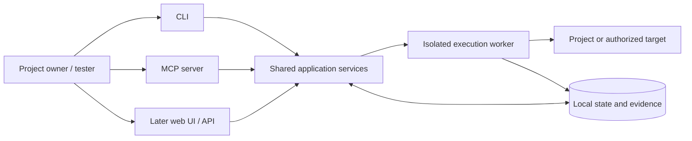

# Technical Architecture Document
## Autonomous Software Testing Platform (ASTA)

**Version:** 1.0  
**Status:** Custom architecture baseline for product development  
**Date:** 2026-11-18  
**Related:** [PRD](PRD.md), [SRS](SRS.md)  
**Implementation:** Not started

## 1. Architecture purpose and decisions

This document defines an architecture that combines user-controlled multi-select testing with deterministic evaluation, explicit authorization, extensible adapters, and a local-first deployment path. It is the reference design for subsequent product decisions and implementation planning.

### Locked product constraints

- Multi-select scope; recommendations outside it require explicit per-run approval.
- Per-domain reports plus one consolidated report.
- Plans and expectations are reviewable before generation/execution.
- Deterministic evaluator; AI cannot set statuses, scope, authorization, or policy.
- Isolated execution, deny-by-default network, and explicit target authorization.
- Bounded retries/fix behavior; preserve all attempts and evidence.
- MCP is an interface to shared application services, not a substitute for the testing engine.

### Technology status

The product is planned as a locally installed standalone application, CLI-first, with optional MCP integration and later UI/API. A concrete Python/SQLite/Docker/Ollama stack is recommended below but remains a proposal until implementation proof points validate platform, licensing, performance, and safety.

## 2. System context

Two standalone architecture diagrams accompany this document: [Simple architecture overview](architecture_overview.html) and [Detailed architecture and trust boundaries](architecture_detailed.html).



CLI is the first interface. MCP and later REST/API or web UI call the same core use cases; no interface may bypass scope, approval, risk, or evaluator controls.

## 3. Logical components

| Component | Responsibilities | Trust boundary / constraints |
|---|---|---|
| CLI / MCP / later API/UI | Accept requests, render status, collect user input, invoke application services | No separate test engine; cannot grant its own authorization. |
| Project intake and authorization gate | Validate folder/archive/repository/target; record project, target, scope manifest, authorization | Archive and URL inputs untrusted; validate before extraction or network. |
| Secrets manager | Store secrets outside ordinary run records; issue scoped references/short-lived access | OS keyring or encrypted store proposed; final choice TBD. |
| Inspector | Detect stack, commands, routes, API specs, existing tests, dependencies, target signals | Static inspection does not execute project modules. Facts carry evidence/confidence. |
| Capability registry | Evaluate installed adapters against project signals; classify applicability, risk, support, prerequisites | Does not expand user selection. |
| Scope resolver | Normalize CLI/config/natural language/profile selections; explain included/excluded/blocked/unsupported | Safety policy is a hard ceiling; extra recommendations require approval. |
| Workflow coordinator | Persist lifecycle, approvals, run state, resume/cancel, bounded retries | Single worker per machine in initial design; idempotent side effects. |
| Planner | Create checks, expectations, provenance, risk, resource limits | Neutral, versioned plan; review before generation. |
| Generation service | Prefer existing tests/formal schemas/deterministic generators; bounded AI assistance | Scripts validated and versioned; stored outside source by default. |
| AI gateway | Bounded task-specific model calls and schema validation | Optional; local Ollama proposed first; remote off by default; cannot change scope/verdict. |
| Adapter registry | Project-native, API, web, accessibility, security, performance, quality tool adapters | Support depends on verified adapter and tool version. |
| Risk/target gate | Recheck exact target/action/risk before execution and each network request | Deny unauthorized hosts, redirects, IPs, metadata endpoints, and disallowed actions. |
| Egress controller | Restrict worker network to approved destinations | No network by default; allowlist and private per-run network when needed. |
| Sandbox controller and worker | Execute approved checks; capture outputs; enforce resource limits and teardown | Docker proposed, not a hostile-code guarantee. Trusted projects/read-only mode until boundary proof. |
| Evidence store | Store redacted artifacts, logs, screenshots, traces, responses, scripts, versions | Local content-addressed files proposed; retention TBD. |
| Evaluator | Deterministic attempt status and run verdict from evidence, expectation, policy | No AI imports/calls. Golden cases for all statuses. |
| Analyzer | Group related findings, compare runs, suggest causes/improvements | Every claim cites evidence; AI inference labeled inferred. |
| Report composer | Domain + consolidated reports and machine exports | No AI verdicts; redaction and schema validation. |

## 4. End-to-end workflow

```text
Intake + authorization
  → inspection and evidence-backed profile
  → scope resolution and applicability
  → recommendations (pending user approval)
  → plan and expectation provenance
  → human edit/approve/exclude
  → deterministic or bounded AI-assisted generation
  → script/path/target validation
  → risk and target recheck
  → isolated execution and evidence capture
  → deterministic evaluation
  → finding analysis and optional comparison
  → domain reports + consolidated report
```

Workflow state proposal:

```text
Project: Active → Archived → Deleted
Plan: Draft → Awaiting review → Approved → Superseded or Executed
Run: Queued → Inspecting → Planning → Awaiting approval → Generating
     → Running → Evaluating → Reporting → Completed
     | Cancelled | Failed | Blocked | Partial
Attempt: Created → Running → Completed(status)
Retry: new attempt; prior attempt and evidence remain immutable
Finding: New → Reviewed → Accepted / Rejected / Deferred / Resolved
```

Recommendations, plan approvals, and risk approvals bind to exact run/scope/plan revisions. Any material scope/plan change invalidates affected approval.

## 5. Scope and capability model

### Resolution flow

1. Parse user’s selected multi-type scope from CLI/config/natural language.
2. Normalize to canonical IDs, aliases, options, and type dimensions.
3. Check project evidence, adapter capabilities, prerequisites, risk, and authorization.
4. Return statuses: Applicable, Not applicable, Unsupported, Blocked, Awaiting authorization.
5. Explain all material included/excluded/blocked decisions.
6. Recommend possible additions separately. Require explicit approval for exact additions.

Runtime security policy is the hard ceiling. Suggested source precedence: runtime policy → explicit per-run user selection → project defaults → reusable profile defaults. Natural-language inference is proposed input, not authorization.

### Canonical check dimensions

Type IDs are versioned. Domain tags may overlap. Keep separate dimensions for test level, protocol, platform, technique, validation intent, and quality check. Deduplicate only when target, operation, and assertion are equivalent; preserve all relevant labels and evidence.

## 6. Planning and expectation provenance

Every planned check records:

- Stable check/scenario key; target and project revision.
- Capability/tags, purpose, prerequisites, risk class, and resource limits.
- Expected outcome/assertion and its source: user criteria, formal specification, existing test, configured threshold, universal check, or AI-inferred.
- Evidence references and confidence for detected project facts.
- Included/excluded/blocked/unsupported/await-authorization rationale.
- Adapter and planned tool version.

Only user criteria, formal specs, existing tests, configured thresholds, and defined universal checks can serve as authoritative oracle sources for Passed/Failed. AI-inferred expectation alone produces Inconclusive.

## 7. Generation and adapter architecture

### Generation preference

1. Reuse and execute existing project tests where selected and supported.
2. Use formal schema/spec-driven deterministic generators where suitable.
3. Use deterministic templates/generators.
4. Use bounded AI assistance to draft scripts only from approved plan, with structured output validation.

### Adapter contract

An adapter declares stable ID, capabilities, applicability signals, risk class, prerequisites, tool/version/license, supported OS/runtime, commands, inputs, outputs, evidence mapping, limits, and unsupported conditions. It must validate configuration and output schemas. Scripts and commands are not arbitrary LLM shell strings.

Candidate first adapters: existing project test runner; REST schema/contract tests; web navigation/forms/accessibility; static/security/secrets/dependency checks. Candidates discussed include Playwright, axe-core, Schemathesis, pytest/HTTPX, Semgrep, Bandit, Gitleaks, pip-audit, OSV-Scanner, OWASP ZAP, and Locust. Versions, licenses, and platform support require verification.

### Language boundary

- White-box unit tests must use target module source language and compatible runtime/build ecosystem unless adapter explicitly declares supported binding.
- Black-box API/E2E/UI/performance tests may use another supported test language against an isolated running target.
- Component/integration checks declare white-box or black-box per scenario.
- No silent language substitution.

## 8. Execution and security architecture

### Baseline trust boundary

Assume project source, archives, dependencies/install hooks, generated scripts, and tool output are untrusted. Docker is proposed but does not by itself guarantee containment of deliberately malicious code. Until egress and isolation proof points pass, permit trusted projects only or read-only analysis.

### Worker controls

- Source mounted read-only; output in separate run workspace; generated tests outside target tree by default.
- Non-root where feasible, reduced capabilities, default seccomp/AppArmor/SELinux policy, no host home or Docker socket.
- CPU, memory, process, disk, output, and wall-clock ceilings.
- No network by default; separate dependency installation phase limited to approved package registries; execution phase offline except approved target.
- Egress proxy/controller enforces allowlisted destinations, redirect checks, DNS/IP/IPv6 checks, and blocks localhost/cloud metadata unless specifically authorized.
- Scoped credentials only; never pass all host environment; redact secrets before persistence; avoid screenshots of credential fields.
- Synthetic/disposable data; explicit approvals for writes, migrations, destructive tests, active scans, and high traffic.
- Cancel/timeout kills worker group; remove containers/networks/volumes/credentials; preserve partial evidence and cleanup outcome.
- Archive validation rejects traversal, unsafe links, device files, and configured size/expansion overages.
- HTML report content is escaped; downloads use safe content types and access checks when API exists.

### Risk classes and approval

| Class | Examples | Rule |
|---|---|---|
| Safe | Static analysis on source copy, sandboxed project tests, read-only requests, passive scans | May run after plan approval within scope. |
| Needs approval | Non-disposable writes, real credentials, database access | Per-check approval. |
| Destructive | Delete/change data, migrations/rollback, fault injection | Per-check approval and disposable target only. |
| Active security | Active scan/fuzz against target | Per-check approval; target in manifest. |
| High traffic | Load, stress, spike, endurance | Per-check approval plus rate/user/duration ceilings. |

Proposed production default: Safe-class checks only; any exception requires exact per-check approval and audit. Final production policy remains a stakeholder decision.

## 9. AI gateway architecture

- All model calls use one gateway with bounded input, task ID, output JSON schema, and validated return/refusal/error.
- Local Ollama is proposed first; remote OpenAI-compatible services are optional and off unless project opt-in is explicit.
- AI-off mode must support rule-based inspection/planning, deterministic generation, execution, evaluation, and reporting.
- Invalid output receives limited configured retries then fallback/degraded state.
- Repository content is untrusted data; no tools/actions exposed to the model that can change target, scope, approvals, evaluator policy, or evidence.
- Remote calls disclose selected content and record provider/model/task/data-sharing decision/outcome.
- Evaluator, sandbox worker, and reporter must not import the AI module.

## 10. Evaluation and status rules

### Attempt status (exactly one)

`Passed | Failed | Flaky | Skipped | Blocked | Inconclusive | Unsupported | Error`

- Deterministic for identical stored evidence, expectations, and policy.
- Preserve all attempts. Failure followed by pass is Flaky.
- Timeout is Failed only if it violates an explicit configured timeout assertion; otherwise Error.
- Missing oracle/criteria -> Inconclusive, not AI-inferred pass/fail.
- Unsupported/missing prerequisites/authorization remain explicit.

### Overall verdict

- **Failures found:** any Failed check.
- **Unreliable results:** no Failed, but Flaky or Error exists.
- **Passed in tested scope:** at least one Passed and no Failed/Flaky/Error.
- **No result:** otherwise.

Verdict always displays scoped counts and limitations; never implies bug-free/secure/compliant.

### Separate suite quality disposition

`Accepted | Needs review | Rejected`, based on execution plus assertion quality, coverage where supported, repeatability, mutation evidence, duplicates, fixture determinism, and configured thresholds. Unavailable evidence is “not measured,” not zero or pass.

## 11. Data and persistence

### Core entities

Project; Target; Requirement; TestPlan; TestCase/Check; Run; TestExecution/Attempt; Finding; Artifact; CredentialReference; ProviderConfiguration; Approval; AuditEvent.

### Proposed storage baseline

- SQLite for local relational project/run/plan/result/audit records.
- Local content-addressed artifact files for scripts, logs, screenshots, traces, responses, and reports.
- SQLAlchemy/Alembic proposed if ORM/migration layer is useful.
- Secrets in OS keyring or selected encrypted secret store, separate from DB.
- PostgreSQL and object storage only as later backends if multi-user/hosted scale requires them.
- Runs capture enough plan/script/tool/evidence/expectation data to replay without another model call.
- Deletion covers project rows, artifacts, prompts, replies, scripts per approved retention policy; exact retention and backup behavior TBD.

These are recommendations only; database, ORM, encryption, and retention choices require validation.

## 12. Interfaces and API

### CLI M1

Candidate commands: `project add`, `inspect`, `plan`, `approve`, `run`, `status`, `cancel`, `rerun`, `report`. Human-readable and optional JSON output; stable exit codes to define. Scope approvals remain explicit.

### MCP integration

Expose shared operations such as project inspection, plan creation/retrieval, approval recording (subject to host/user confirmation), run start/status/cancel, and report/evidence retrieval. MCP tools are an integration surface; the app’s own CLI remains the dependable approval path because host interaction capabilities differ.

### REST API / web UI M3 candidates

Proposed versioned routes (not locked):

```text
POST /api/v1/projects; GET/DELETE /api/v1/projects/{id}
POST /api/v1/projects/{id}/targets
POST /api/v1/projects/{id}/inspections
POST /api/v1/projects/{id}/plans; PATCH /api/v1/plans/{id}
POST /api/v1/plans/{id}/approvals
POST /api/v1/runs; GET /api/v1/runs/{id}
POST /api/v1/runs/{id}/cancel; POST /api/v1/runs/{id}/rerun
GET /api/v1/runs/{id}/executions; GET /api/v1/findings
GET /api/v1/artifacts/{id}; GET /api/v1/runs/{id}/report?format=...
```

Proposed local single-user token auth needs detailed design: token creation/storage/rotation/network binding/roles. Routes and auth are not finalized requirements.

## 13. Recommended technology stack

| Layer | Recommendation | State |
|---|---|---|
| Core | Python modular monolith | Recommended; validate supported targets and packaging. |
| CLI | Typer | Candidate. |
| Workflow | Persisted Python state machine first; LangGraph if branching/checkpoint needs warrant it | Recommendation to avoid framework complexity until proven. |
| Database | SQLite local-first | Candidate for single-machine/one-worker; abstract persistence. |
| ORM/migrations | SQLAlchemy/Alembic | Candidate. |
| Worker | One worker per machine, DB-backed job record | M1 baseline; bounded concurrency. |
| Sandbox | Docker, rootless where supported, strict egress policy; no claim of hostile-code safety | Proposed; prove or restrict to trusted projects/read-only analysis. |
| AI | Ollama local-first, remote opt-in/off by default | Proposed; select model after latency/quality/license benchmark. |
| API | FastAPI + Pydantic | M3 candidate; consistent error contract required. |
| UI | React + TypeScript + Vite | M3 candidate. |
| Reports | Markdown + versioned JSON, later HTML/JUnit XML/SARIF | M1/M3 candidate formats. |
| Queue | No distributed queue initially; consider Celery/RabbitMQ only if measured | Avoid premature infrastructure. |
| Storage | Local content-addressed files; object storage later if scale needs | Proposed. |

## 14. Observability and operability

- Structured logs with run/component/attempt IDs and secret redaction.
- Store durations separately for inspection, planning, queue, execution, evaluation, and reporting.
- Record applied worker limits and tool/model versions.
- Health distinguishes CLI/core, worker, adapters, model gateway, and persistence readiness.
- Recover interrupted jobs without false Passed result; record whether rerun/recovery occurred.
- Audit approvals, target decisions, AI data-sharing calls, egress decisions, cancellations, and artifact access.

## 15. Milestones and proof gates

| Milestone | Scope | Exit evidence |
|---|---|---|
| M1 — Foundation | Bug garden, core records/audit, intake/scope/secrets, inspector, sandbox proof, registry, existing-test adapter, evaluator, CLI/reports/state machine | Full CLI run; evaluator goldens; replayable reports; network/sandbox proof; benchmark baseline. |
| M2 — AI and core adapters | Ollama gateway/fallback, plan review, REST adapter, web/a11y adapter, static/security/secrets/dependencies/code-quality | Run with AI unavailable; fixtures identify planted issues; AI cannot change scope/verdict. |
| M3 — Interfaces and analysis | Bounded performance, passive ZAP, analyzer/comparison, REST API, React UI | Risk gates block unapproved scan/load; report formats validate; UI drives run; cancellation/history work. |
| Later | Database/visual/cross-browser/protocol expansion, fuzz/property/mutation, container/Kubernetes, fix mode, CI, multiple users, Android | Each adapter has applicability, evidence, safety review, license review, acceptance tests before release claim. |

### Security and product proof points before execution claims

- Worker reaches one authorized host but cannot reach denied hosts, local services, or cloud metadata.
- Test direct IP, redirects, IPv6, DNS, archive traversal, package install, and egress rules.
- Confirm source, credentials, logs, screenshots, prompts, and remote calls comply with privacy/retention policy.
- Measure local model latency, invalid structured output, memory use, and AI-off fallback.
- Compare AI-on and AI-off benchmark precision/recall/false positives/runtime.
- Verify tool/model licenses and platform support before distribution.

## 16. Risks and mitigations

| Risk | Mitigation |
|---|---|
| Docker insufficient against malicious code | Trusted-only projects/read-only mode until proof; evaluate VM isolation later. |
| Egress/SSRF bypass | Check targets before every request; deny local/metadata; test redirects, DNS, IPv6, direct IP. |
| Arbitrary project startup | Start with narrow profiles and explicit run commands; unknown startup is Blocked. |
| Weak model-generated assertions | Deterministic generators first, oracle provenance, AI-off benchmark, no AI-only pass/fail. |
| Insufficient business oracle | Request user criteria/formal spec; classify Inconclusive. |
| Noisy performance results | Require workload/threshold; record environment; qualify same-host results. |
| Remote source disclosure | Local AI first; remote off by default; preview selected content and audit opt-in. |
| Misleading overall verdict | Display scope, gaps, all status counts, limitations, and incomplete state. |
| Licensing/platform incompatibility | Verify exact tools/models and OS support before adoption. |

## 17. Open decisions

OS/hardware/WSL2/Docker support; project/package name; initial project languages; archive size/file/expansion caps; trusted-only duration versus stronger sandbox; retry/flaky policy; severity scale; benchmark thresholds; model and hardware requirements; privacy/retention/encryption; tool/model licenses; API auth/multi-user roles; production testing policy; fix mode timing; traffic ceilings; latency/concurrency/SLA; remote AI opt-in UX; and exact adapter/tool versions.

## 18. Reference documentation

These vendor/standards sources describe current capabilities and constraints; they do not constitute product decisions or a security certification.

- [Model Context Protocol — Python SDK overview](https://py.sdk.modelcontextprotocol.io/get-started/first-steps/): host/client/server roles and tools, resources, and prompts.
- [LangGraph persistence](https://docs.langchain.com/oss/python/langgraph/persistence): checkpointing and persistence capabilities relevant to durable approval workflows.
- [FastAPI features](https://fastapi.tiangolo.com/features/): typed request/response and OpenAPI/JSON Schema capabilities relevant to a later API.
- [Docker Engine security](https://docs.docker.com/engine/security/): container, daemon, namespace, and hardening considerations.
- [Docker rootless mode](https://docs.docker.com/engine/security/rootless/): rootless execution and its prerequisites/limitations.
- [Docker seccomp profiles](https://docs.docker.com/engine/security/seccomp/): syscall filtering and default profile guidance.
- [Python `sqlite3` documentation](https://docs.python.org/3/library/sqlite3.html): transaction/thread-safety considerations for local persistence.

